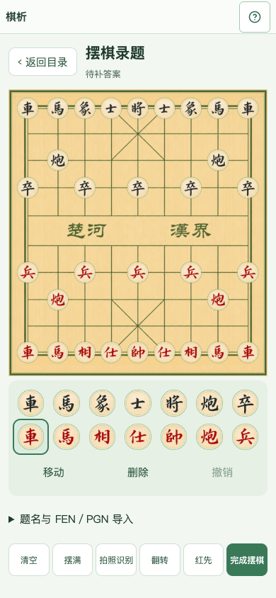
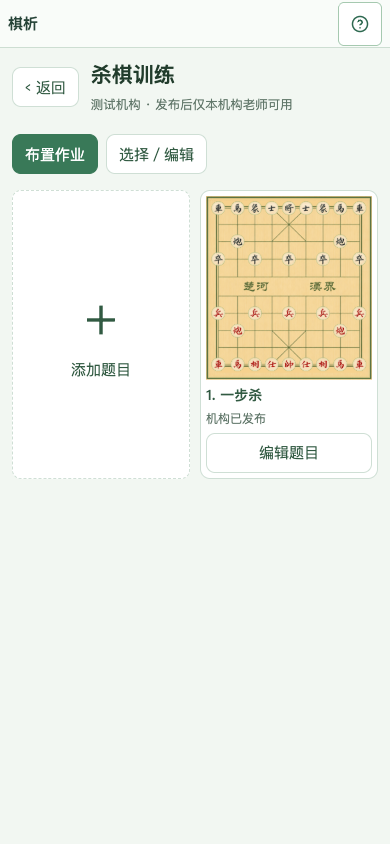
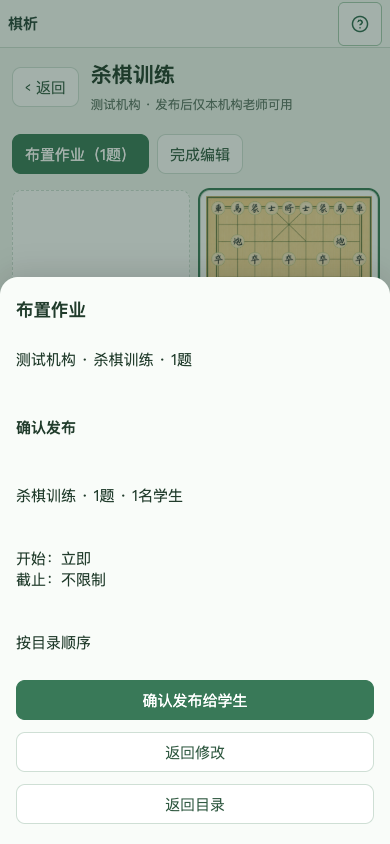
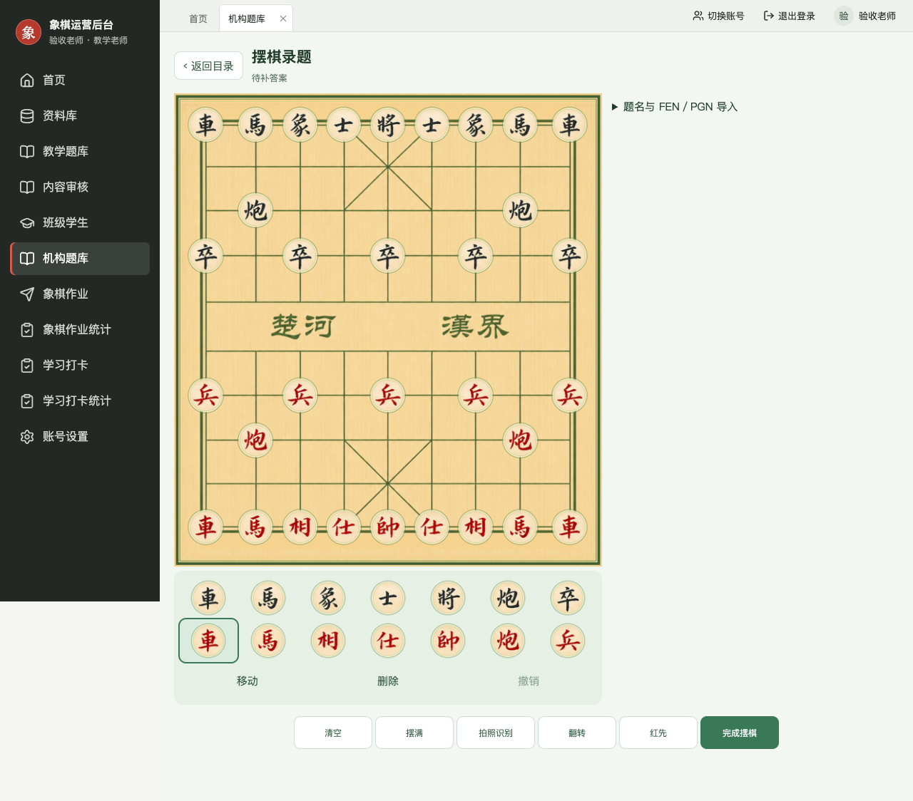

# 移动端机构出题与布置作业验收（2026-10-28）

实现仓库：`chess-studio` 的教学移动端；`xiangqi-admin-private` 的后台与 Axum 服务。未部署生产，也未修改业务数据库；数据库验收在自动创建并销毁的本机临时 MySQL 中执行。

## 已实现

- 老师首页 → 机构题库 → 有序目录 → 棋盘缩略图 → 手动摆棋/图片识别/FEN/PGN/已有棋谱/平台或机构题目。
- 先存局面草稿，回目录连续录题；答案、训练目标、讲解、教师试做后再发布到机构题库。杀棋强制杀验证，得子/取胜/守和沿用确认答案树规则。教师试做不提交学生成绩。
- 目录多选、排序、改名、移出和事务移动。移出保留原题；复制他人题目进入可写目录，并保留来源。
- 草稿仅作者/本机构管理员可读写，同机构老师只看到发布版本；自建题不伪装成 CBL 文件，不进入平台公开目录。作业保存不可变快照。
- 修订/下架均校验版本。修订稿不可直接布置，避免老师看新棋盘、学生收到旧棋盘；同事仍可使用其可见的已发布版本。跨端冲突保留本机编辑，允许另存。
- 选题后直接打开布置面板，明确选择学生/班级，保留目录顺序；高级设置含时长、次数、答案查看、随机、分批。
- 服务端 UTC 开始时间约束、截止时间校验、去重收件人、事务幂等发布；未知网络结果保留请求键与原始内容，明确拒绝可修正，部分成功可取消余批并保留已发布作业。
- 移动端和后台使用同一套四个创作组件文件，通过 `scripts/sync-teacher-authoring.mjs` 同步并 `--check` 检查。

## 验证及证据

- 移动端 Node 逻辑测试 61 项通过。
- 移动端 UI 完整套件 116 项通过；新增作者流程测试覆盖保存返回、同格移动不删子、翻转与黑先、离线草稿、识别确认恢复、重试键、明确失败修正、未发布修订阻止布置、离线冲突保留、非破坏性答案分支。
- 后台 Rust 非忽略测试 67 项通过；需外部资源的既有测试仍忽略。引擎进程测试首次全套曾出现临时 PID 文件时序失败，单独重跑及后续全套均通过。
- `scripts/test-authoring-db.py` 使用独立临时 MySQL 验证机构隔离、作者权限、发布/修订/下架、目录计数、版本冲突、作业快照、未来开始拒绝、截止校验、截止后成功请求重试、目录移动后追加题序；未写入学生成绩。
- 两端前端构建、后台编译、桌面及同步服务 Rust 检查通过。
- `scripts/test-teacher-authoring-ui.cjs` 对实际 Vite 页面使用隔离 API fixture 验证 390/768px 移动端及 1280px 后台，页面无横向溢出，并验证相册选图、旋转、JPEG 上传及保存前确认。此项属于浏览器模拟验收，不等于 iOS/Android 真机或远程测试环境验收。

## 图片识别边界

识别在自有服务 Python 子进程完成，原图只经 stdin 进入内存，不落磁盘或发送第三方。提供旋转、裁剪、低置信度标记和手动纠正，必须核对全部棋子、方向及先走方后才能保存。服务限制 12MB、45 秒和两路并发；Pikafish 建议另限制两路并发。

本机使用既有、带许可证的 YOLO11 ONNX 模型测试：

| 样例 | 棋子数 | 对照结果 |
|---|---:|---|
| 当前皮肤截图 | 32 | 90/90 格一致 |
| 90°旋转后经编辑器方向纠正的截图 | 32 | 90/90 格一致 |
| 180×200 低清截图 | 32 | 90/90 格一致 |
| 仓库既有书本照片单图裁剪 | 32 | 87/90 格一致；兵误作马、马误作车、红车误作黑车 |

样本很少，书本照片仍必须人工修正，不能宣称自动识别全部准确。未覆盖实物棋盘、整页多题、透视严重或任意旋转角度自动纠正。部署测试服务前需按 companion 仓库的 `docs/teacher-authoring.md` 安装识别依赖、配置模型及引擎；本次未执行远程部署。

## 审查结果

Standards：两轮审查发现并修复发布失败冻结、同格误删、下架版本漏洞、引擎并发无界、幂等哈希顺序及移动后追加顺序问题。

Spec：两轮审查发现并修复新离线草稿不可恢复、复制到不可写目录、未发布状态泄漏、识别确认丢失、跨端离线稿覆盖、修订显示/布置版本不一致及立即开始截止校验问题。

仍需现场验收：iOS/Android 摄像头与相册权限、真实移动网络断连，以及配置识别/引擎后的远程测试服务联调。未包含生产发布。
